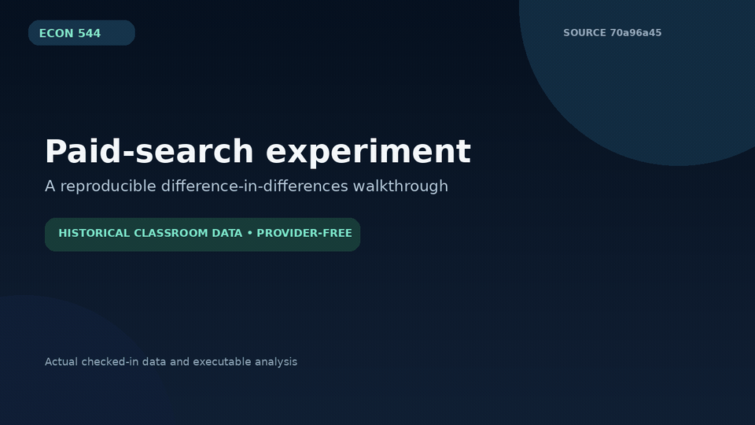

# ECON 544 notebooks

Course notebooks for statistical decision-making, forecasting, portfolio and
operations examples. The repository includes the historical classroom inputs;
no live advertising, brokerage, provider, or production integration is used.

## Reproducible paid-search workflow

The original paid-search notebook now has a portable, validated command-line
path that works from any current directory and preserves the bundled CSV:

```bash
python -m pip install -r requirements-demo.txt
python scripts/run_ads_did.py --output /tmp/ads-did-receipt.json
python -m unittest discover -s tests -v
python scripts/verify_demo.py
```

The estimate is a classroom difference-in-differences calculation over the
checked-in historical dataset. It is not a current causal, business-performance,
or advertising-platform claim.



[MP4 version](docs/demo/ads-did-demo.mp4) · [machine-readable receipt](docs/demo/receipt.json)

The other notebooks retain their original instructional dependencies. The two
historical Conda exports are preserved as archival environment snapshots; the
small pinned `requirements-demo.txt` covers the verified workflow above.
